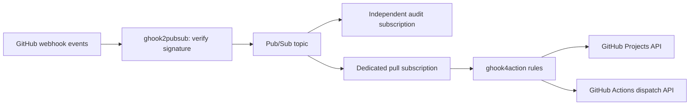

# Architecture

The application consumes the original webhook body, not a Pub/Sub push envelope. It supports JSON and form-urlencoded `payload` bodies, plus gzip/zstd compression marked by the `compression` message attribute. Decoded data is bounded to limit memory use. `gh_event` identifies the webhook kind; the payload supplies action, base repository privacy/owner/name, and the issue or pull request node ID. Pull request fork privacy is never used for routing.

Project-only subscriptions can filter on `attributes.action = "opened" AND (attributes.gh_event = "issues" OR attributes.gh_event = "pull_request")`. Filtering reduces traffic; rule matching still runs in the application. Privacy cannot be filtered at subscription level because it is inside the body. [Workflow orchestration](WORKFLOWS.md) documents the broader filter for workflow and push events.

The GitHub client resolves configured organization/project numbers and calls `addProjectV2ItemById`. GitHub returns the existing item when it is already present, so duplicate deliveries and retries after partial rule execution are safe. See [GitHub Projects API documentation](https://docs.github.com/en/issues/planning-and-tracking-with-projects/automating-your-project/using-the-api-to-manage-projects).

Only successful processing and valid unmatched events are acknowledged. Decode failures and GitHub/network/permission errors are negatively acknowledged. No payload is logged. Failure logs contain a redacted failure reason and the Pub/Sub message ID for correlation with the separate audit stream. Configure subscription backoff/dead lettering operationally to avoid repeated poison deliveries; without a dead-letter policy failed messages retry until retention expires. A failed action may have succeeded remotely. Project additions are idempotent; workflow dispatches are not. Redelivery or partial failures can trigger duplicate runs, so downstream automation must deduplicate source revisions or run IDs.

Subscriber flow control limits concurrent outstanding messages. Shutdown cancels Receive and lets in-flight callbacks finish. Readiness remains false until startup resolves all configured projects and workflows using the selected credentials. It does not continuously check downstream GitHub permission or Pub/Sub connectivity. GitHub App installation tokens are refreshed in memory before expiration. No inbound webhook endpoint, repository checkout, or code execution is needed.

Workflow runs normalize head branch/SHA, workflow path, original event, conclusion, and run ID/attempt into routing data. Fork or missing head repository metadata cannot match workflow branch rules. Pushes normalize only `refs/heads/` branches; tag pushes and branch deletions do not dispatch. Targets and refs come exclusively from local operator configuration. Explicit source input mappings copy a fixed set of metadata fields without evaluating templates or following payload URLs. The fixed GitHub REST endpoint dispatches a selected downstream workflow using the same cached installation token mechanism as project actions.
