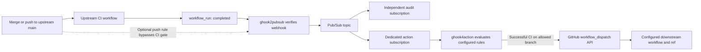
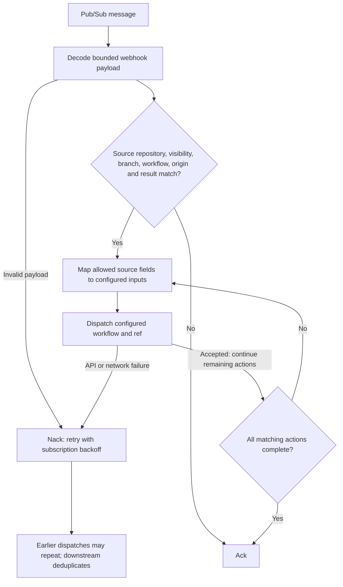

# Workflow orchestration

Use ghook4action to connect workflows across repositories through operator-owned rules. A typical rule waits for successful CI on the upstream repository's `main` branch, then dispatches a particular workflow in a downstream repository. Source and destination branches are independent. Multiple actions or matching rules can fan out to several repositories; downstream completions can feed further explicitly configured rules.



Prefer `workflow_run` completion when downstream work depends on CI passing. A push event fires immediately, including direct pushes; it does not establish that checks passed or that the commit arrived through a merge. Enforce merge requirements through repository branch protection. Each completion rule selects one upstream workflow; this is not an aggregator that waits for several independent CI workflows.

## Configure the rule

Start with [examples/workflows.json](../examples/workflows.json). Replace the example organization, visibility, repository names, workflow paths, and destination. Validate without credentials or network access:

```sh
go run . --rules-file examples/workflows.json --check-config
```

A `workflow_run` rule requires:

| Match field | Meaning |
| --- | --- |
| `events: ["workflow_run"]` | Exactly one event kind per orchestration rule. |
| `actions: ["completed"]` | Only completed runs qualify. |
| `repository_owner`, `repository_private`, `repositories` | Explicit source organization, visibility, and repository names. |
| `branches: ["main"]` | Exact source head branch names for non-release origins, case-sensitive; no globs. Release origins use `tag_patterns` instead. |
| `workflow_paths: [".github/workflows/ci.yml"]` | Exact source workflow paths, case-sensitive. |
| `workflow_events: ["push"]` | The event that originally started upstream CI. |
| `conclusions: ["success"]` | Explicit accepted results; completion alone does not imply success. |

Fields are ANDed; values inside each array are ORed. Owner/repository names are case-insensitive. Other accepted branch-based origins are `workflow_dispatch`, `schedule`, `repository_dispatch`, and `workflow_run`; pull request origins are intentionally excluded from orchestration. Fork head repositories and missing head repository metadata cannot match. Other supported conclusions are `failure`, `neutral`, `cancelled`, `skipped`, `timed_out`, `action_required`, `stale`, and `startup_failure`.

The `workflow_dispatch` action contains a `workflow` object:

| Field | Meaning |
| --- | --- |
| `owner`, `repository` | Explicit downstream destination, covered by the configured installation/token. |
| `id` | Workflow filename such as `deploy.yml`, or numeric workflow ID as a string. |
| `ref` | Explicit downstream branch or tag; independent of the upstream branch/SHA. |
| `inputs` | Optional literal string inputs. |
| `source_inputs` | Optional mapping from destination input names to supported source metadata. |

Supported source selectors are `repository` (`owner/name`), `branch` (the source `head_branch`, which contains the tag for release-originated runs), `sha`, `event` (the webhook kind), `workflow_path`, `run_id`, and `run_attempt`. The last three require `workflow_run`. For example, `"source_sha": "sha"` passes the upstream commit as the downstream `source_sha` input. Input names must start with a letter or underscore and contain only letters, digits, underscores, or hyphens. Literal and source mappings cannot overlap; the combined limit is 25. All values are strings. These are explicit field mappings, with no template engine or arbitrary payload access. Do not put secrets in inputs.



## Release asset completion

To rebuild a consumer when a producer has finished publishing release assets, match the producer's successful `workflow_run` completion with `workflow_events: ["release"]`. This waits for the selected workflow to finish; a `release` webhook alone does not establish that its asset-upload jobs have completed. No notification workflow or dispatch step is needed in the producer.

GitHub release runs use the release tag in `workflow_run.head_branch`. Release-origin rules therefore require `tag_patterns` and forbid `branches`. A release origin cannot be combined with other origins in one rule; use separate rules for branch-based CI and release publication. All existing source owner, repository, visibility, exact workflow path, completion action, conclusion, and same-repository head checks still apply. Fork heads and missing head-repository or ref metadata never match, even with `"*"`.

```json
{
  "events": ["workflow_run"],
  "actions": ["completed"],
  "repository_owner": "example-org",
  "repository_private": true,
  "repositories": ["upstream"],
  "tag_patterns": ["v[0-9]*"],
  "workflow_paths": [".github/workflows/release.yml"],
  "workflow_events": ["release"],
  "conclusions": ["success"]
}
```

Tag patterns are case-sensitive [Go `path.Match` globs](https://pkg.go.dev/path#Match), not regular expressions or GitHub Actions minimatch expressions. `*` matches zero or more non-slash characters, `?` matches one non-slash character, and character classes such as `[0-9]` are supported. Patterns match the complete tag; `v*` does not match `releases/v1.0.0`. Multiple patterns are alternatives. Empty, whitespace-only, malformed, or multiline patterns fail validation. `tag_patterns` is valid only for release-origin workflow rules, not push webhooks or project routing. See [the complete release rule example](../examples/release-workflow.json).

The downstream workflow and its ref remain explicit and independent of the producer tag. Without pinned artifact inputs, the consumer resolves whatever its build calls the latest release; prerelease or older-release completions may rebuild without changing that selection. Success gates the entire source workflow, so a failure in an unrelated job can suppress dispatch even after assets were uploaded. Reruns and duplicate deliveries can repeat downstream builds. A periodic consumer build can still refresh base images and dependencies that have no configured producer event.

## Downstream workflow contract

The target workflow must declare `workflow_dispatch` and all configured input names. Ensure the workflow exists on the downstream default branch and at the configured ref. For the example configuration, the trigger block is:

```yaml
on:
  workflow_dispatch:
    inputs:
      environment:
        type: string
        required: true
      source_repository:
        type: string
        required: true
      source_sha:
        type: string
        required: true
      source_run_id:
        type: string
        required: true
      source_run_attempt:
        type: string
        required: true
```

Add this trigger to your reviewed downstream workflow. GitHub runs the downstream workflow at `ref`; passing `source_sha` does not change its checkout automatically. Downstream jobs should validate their expected source repository and treat inputs as data, using environment variables rather than interpolating inputs into shell commands. The orchestrator never checks out source repositories, executes payload content, or follows payload URLs. See [GitHub workflow dispatch API](https://docs.github.com/en/rest/actions/workflows#create-a-workflow-dispatch-event) and [workflow trigger requirements](https://docs.github.com/en/actions/reference/workflows-and-actions/events-that-trigger-workflows#workflow_dispatch).

## Optional push trigger

To dispatch immediately on updates to a branch, use a separate rule with this match object and the same destination action:

```json
{
  "events": ["push"],
  "repository_owner": "example-org",
  "repository_private": true,
  "repositories": ["upstream"],
  "branches": ["main"]
}
```

Omit match `actions`, `workflow_paths`, `workflow_events`, and `conclusions` for pushes. Remove workflow-only `source_inputs` (`workflow_path`, `run_id`, `run_attempt`) and adjust the downstream input contract accordingly. Tags and deleted branches never dispatch. Configuring both push and CI completion rules for the same source intentionally produces two dispatches.

## GitHub permissions and event delivery

The action application's GitHub App needs repository **Actions: read and write** on downstream repositories. Startup reads destination workflows to verify visibility before consuming; this cannot prove dispatch write access, input-schema correctness, or ref existence. Project-only deployments retain their existing permissions. Dispatch-only deployments request only Actions write; mixed rules request both permission sets. Approve any updated App permissions for the installation before rollout.

The configured installation must cover every destination repository. One process currently uses one installation/token; for destinations in multiple organizations use separate deployments with separate rules, installations, and dedicated subscriptions, or a static token with suitable access.

The webhook receiver must subscribe to **Workflow runs** for completion rules and **Push** for push rules, and publish them through ghook2pubsub. For an App-based receiver, Workflow runs requires repository **Actions: read**, and Push requires **Contents: read**; these permissions belong to the receiver and are separate from dispatch permissions. If the same App handles receiving and dispatching, grant the combined permissions. Confirm the receiver allows these event kinds. See [GitHub webhook events](https://docs.github.com/en/webhooks/webhook-events-and-payloads#workflow_run).

The original opened-only Pub/Sub filter will exclude these events. For mixed project and workflow routing, provision a dedicated subscription with:

```text
(attributes.action = "opened" AND (attributes.gh_event = "issues" OR attributes.gh_event = "pull_request")) OR (attributes.gh_event = "workflow_run" AND attributes.action = "completed") OR attributes.gh_event = "push"
```

For dispatch-only routing, omit the first clause and any unused event kinds. Push events have no action attribute. Branch, workflow path, origin event, conclusion, and repository privacy are matched from the body inside the application. [Pub/Sub subscription filters are immutable](https://docs.cloud.google.com/pubsub/docs/subscription-message-filter): create a replacement subscription when changing the filter, plan the backlog cutover, and avoid running overlapping consumers that dispatch the same event. The application does not modify cloud resources or App permissions.

## Retries, duplicates, and loops

Delivery is at least once. The application acknowledges after all matching actions succeed. API failures retry the message, including any earlier successful dispatches. A timeout can happen after GitHub accepts a dispatch. There is no persistent deduplication ledger or exactly-once guarantee. HTTP acceptance confirms submission, not downstream workflow success; downstream failures do not retry the original dispatch automatically.

Make downstream side effects idempotent. Persist a processed key based on `source_repository` and `source_sha`, or `source_repository` plus `source_run_id` (include `source_run_attempt` if reruns should execute again). Workflow concurrency groups can serialize runs but do not provide durable deduplication. Upstream reruns generate new completion events and can dispatch again.

Keep workflow chains acyclic. Prefer source `workflow_events: ["push"]`, exact workflow paths, and separate upstream/downstream repositories so a dispatched downstream completion cannot match its own source rule. Explicitly opting into `workflow_dispatch` or `workflow_run` origins can enable chains and cycles; review the complete route graph before rollout. Configure Pub/Sub retry backoff and dead lettering as described in [Operations](OPERATIONS.md), and inspect retained backlog before enabling a route because historical events may dispatch workflows.
